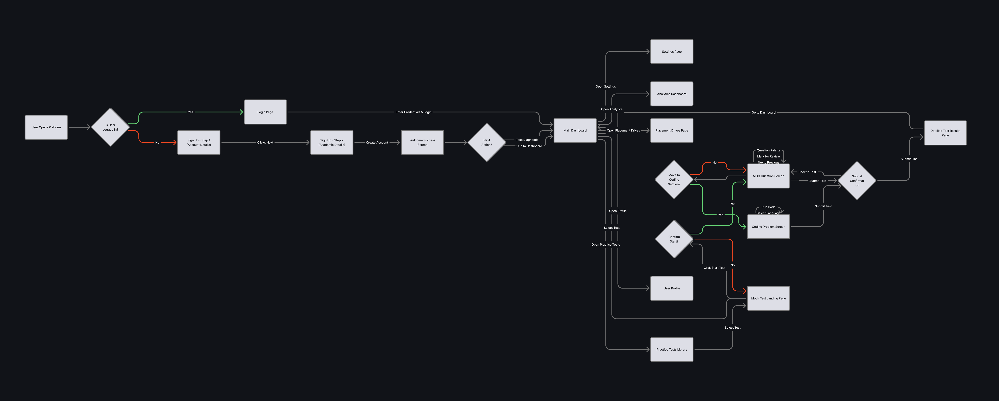
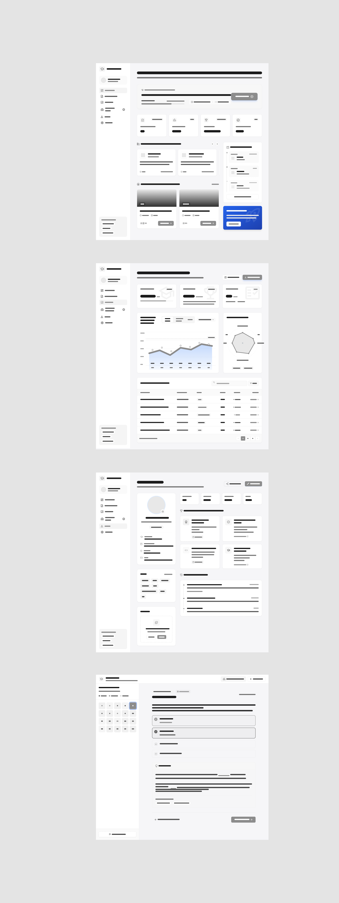
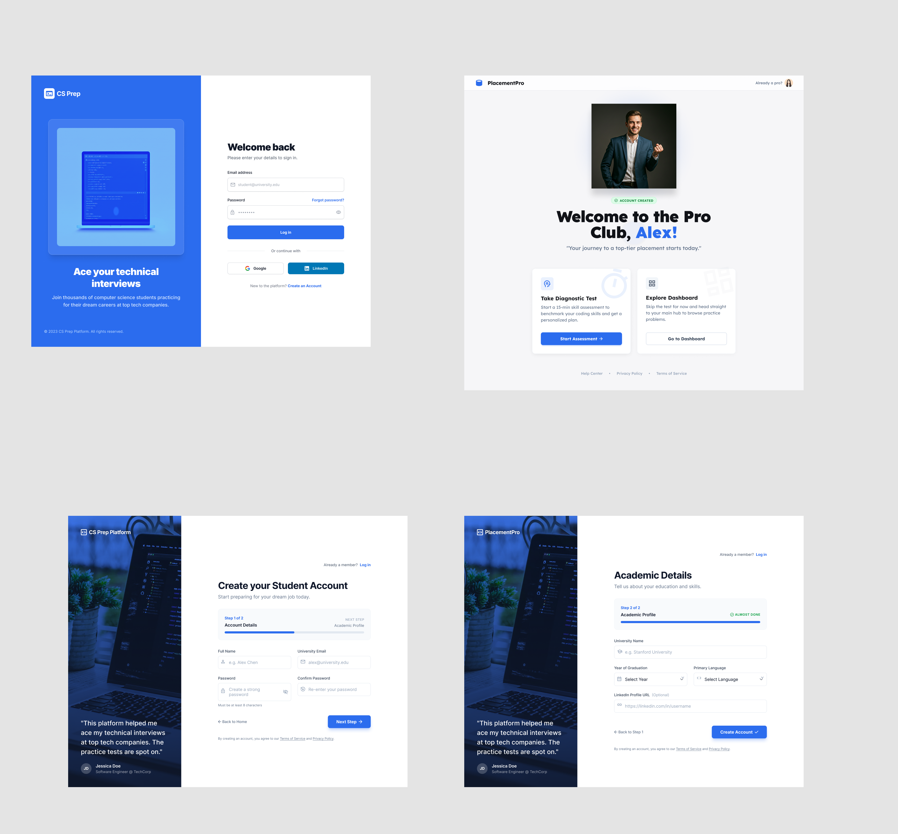
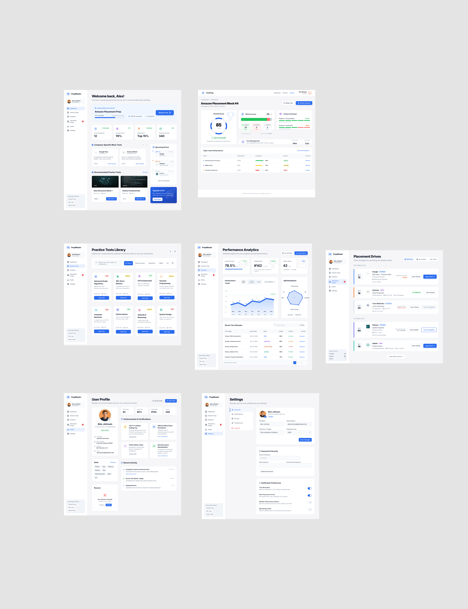
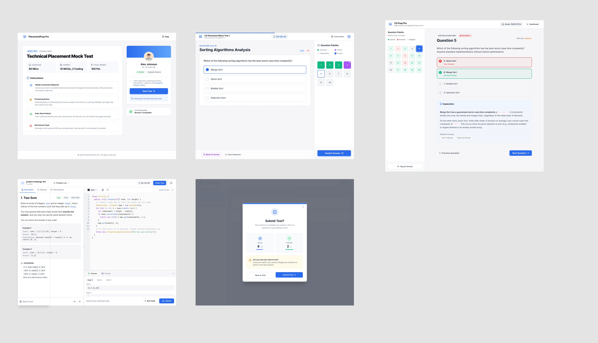

# PlacementPrep Pro — Online Proctored Examination & Coding Test Platform | UI/UX Case Study

---

## 1. Project Overview

**PlacementPrep Pro** is an end-to-end online examination and coding assessment platform engineered to conduct high-stakes campus placement tests, competitive coding trials, and corporate recruitment evaluations. 

As the **Lead UI/UX & Product Designer**, I structured the complete human-centered design workflow — traversing from user flow mapping and low-fidelity wireframing to high-fidelity proctored test dashboards, split-screen live coding workspaces, and testcase execution consoles.

---

## 2. Problem Statement

Online assessment platforms (HackerRank, Mercer Mettl, Codility) frequently introduce high cognitive anxiety and usability friction for candidates under timed constraints:
1. **Accidental Submission Panic:** Candidates inadvertently click "Finish" or submit tests before completing all coding problems.
2. **Context Switching Friction:** Juggling between problem statements, constraints, code editors, and input/output consoles causes disorientation on small viewports.
3. **Disruptive Proctoring Alarms:** Harsh proctoring warnings often distract candidates rather than guiding them gently.
4. **Poor Status Visibility:** Inability to easily track which questions are answered, skipped, or flagged for review under pressure.

---

## 3. Project Goals & UX Principles

- **Zero-Accidental-Submission Architecture:** Implement an attempt summary verification modal that requires explicit confirmation while reviewing answered vs unanswered tallies.
- **Unified Split-Screen Coding Workspace:** Position problem specifications, live multi-language code editors, and testcase runner consoles within a single zero-scroll viewport.
- **Glanceable Question Palette:** Real-time visual status coding (Green: Answered, Red: Skipped, Purple: Flagged for Review, Gray: Unanswered).
- **Proctoring Transparency:** Explicit countdown timers, 30-second auto-save status telemetry, and clear academic integrity indicators.

---

## 4. End-to-End Design Workflow & Artifacts

### 🗺️ Step 1: Complete UX User Flow Mapping
*Mapping every decision branch from candidate authentication and proctoring verification to test execution, auto-save triggers, and final attempt submission.*

---

### 📐 Step 2: Low-Fidelity Wireframing & Layout Exploration
*Exploring layout density, side-by-side coding editor splits, question palette positioning, and navigation buttons before visual styling.*

---

### 🔐 Step 3: High-Fidelity Authentication & Onboarding
*Clean, distraction-free candidate entry prioritizing institutional single-sign-on (SSO), hall ticket verification, and test instructions.*

---

### 💻 Step 4: Proctored Test Dashboard, MCQ Engine & Split-Screen IDE
*High-density examination workspace featuring question palettes, rich code snippet questions, live Two-Sum coding challenge, testcase runner console, and the attempt summary modal.*

---

### 📋 Step 5: Test Format & Assessment Constraints Specification
*Original assessment brief and test constraints modeled during research.*

---

## 5. Key Interaction Decisions

1. **Attempt Summary Confirmation Modal:**  
   Before final test submission, a modal displays a clear breakdown (e.g., *"Coding: 2/2 Complete, MCQs: 8/10 Answered"*). This completely eliminates accidental submission drop-offs.
2. **Tabbed Testcase Console:**  
   Allows candidates to execute custom test cases (Case 1, Case 2, Case 3) and review compiler outputs without leaving the code editor.
3. **Persistent Auto-Save Telemetry:**  
   Displaying *"Saved 2m ago"* next to the language switcher reassures candidates against network drops or session timeouts.

---

## 6. Design System & Accessibility

| Category | Specification |
|---|---|
| **Typography** | Technical geometric sans-serif paired with monospaced code fonts for syntax legibility |
| **Status Tokens** | Semantic green (Answered), amber (Flagged for Review), slate (Unanswered), blue (Active) |
| **Grid & Density** | Information-dense layout optimized for 1366x768 and 1920x1080 campus laboratory monitors |
| **Accessibility** | Strict WCAG 2.1 AA contrast compliance across all text labels and interactive controls |

---

**Obaidhur Rahaman** | [rahaman1721.framer.website](https://rahaman1721.framer.website) | [LinkedIn](https://www.linkedin.com/in/obaidhur-rahaman-1721z) | [GitHub](https://github.com/rahaman1721)
